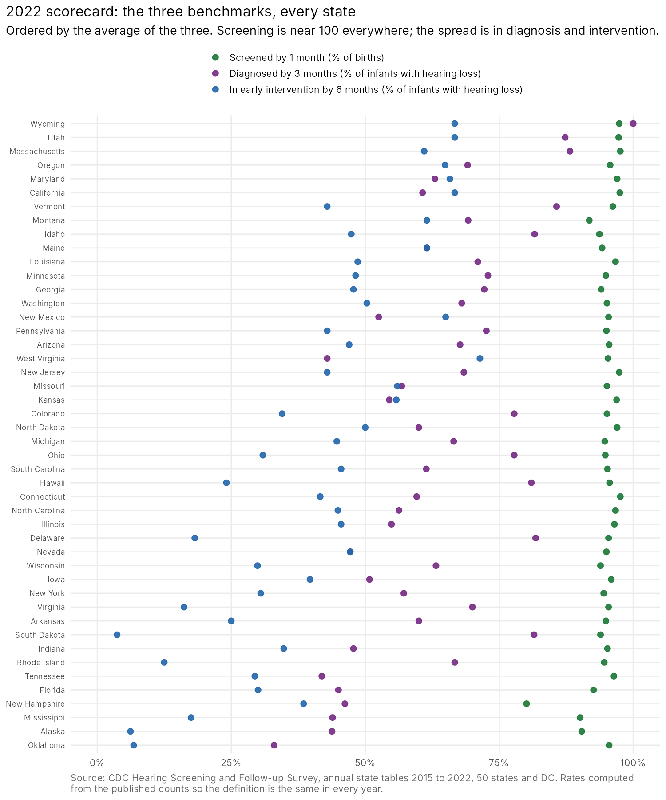
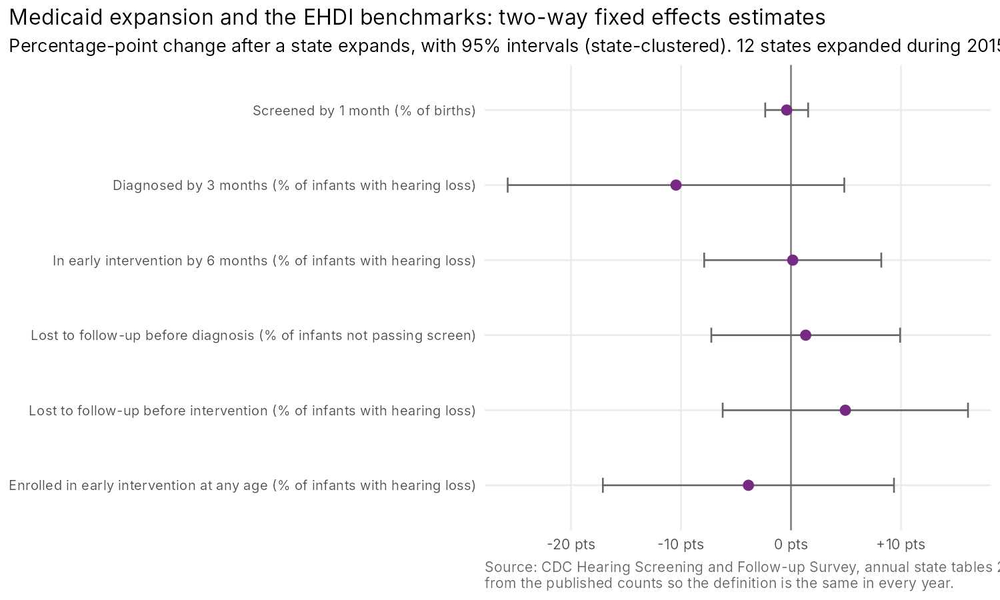

# EHDI 1-3-6 scorecard, 2015 to 2022

Every state's record on the three Early Hearing Detection and Intervention benchmarks: hearing screening by 1 month of age, diagnosis by 3 months, and enrollment in early intervention by 6 months. Built from CDC's annual Hearing Screening and Follow-up Survey (HSFS) tables for all 50 states, DC, and the territories, 2015 through 2022, as a tidy state-year panel with the rates recomputed from the published counts so they mean the same thing in every year.

I run a national organization for families of deaf children, and the 1-3-6 numbers are the ones that decide whether a child arrives at kindergarten with language. CDC publishes them one year and one table at a time. This repository puts eight years side by side.

## What the panel shows

- **The 1 is solved. The 3 and the 6 are not.** In the median state in 2022, 95 percent of babies were screened by 1 month, 62 percent of those identified as deaf or hard of hearing were diagnosed by 3 months, and 45 percent were in early intervention by 6 months. In 2015 the same three numbers were 96, 58, and 42. Seven years of federal grants moved the diagnosis benchmark four points and the intervention benchmark three.
- **No state gets 80 percent of its deaf and hard of hearing infants into early intervention by 6 months.** Twelve states are under 30 percent. The best large states in 2022 are California (67 percent of 923 infants), Utah (67 percent), Maryland (66 percent), Oregon (65 percent), and Massachusetts (61 percent).
- **Loss to follow-up before diagnosis is the leak.** In the median state, 28 percent of infants who did not pass their screen in 2022 were never documented as diagnosed. In fourteen states it was over half: Oklahoma (83 percent), South Dakota (77), Montana (67), Georgia (61), Alaska (60), Texas (57), Mississippi (53), and others. Oklahoma diagnosed a third of its deaf and hard of hearing infants by 3 months and enrolled 7 percent by 6 months.
- **Georgia's follow-up collapsed.** Diagnostic loss to follow-up went from 26 percent of non-passing infants in 2015 to 61 percent in 2022, while the state's diagnosis-by-3-months rate rose, which means the children who are found are found quickly and a growing share are never found at all.
- **Progress is not monotonic.** On the 6-month benchmark, 22 states improved between 2015 and 2022 and 21 went backward. New Mexico (+43 points), West Virginia (+43), and Maine (+33) show it can be done. Rhode Island fell from 70 percent to 13; Mississippi from 53 to 18.
- **Medicaid expansion does not explain the differences.** Non-expansion states look worse in the 2022 cross-section (median 30 percent in EI by 6 months, against 43 in expansion states; 39 percent lost before diagnosis against 24). But a two-way fixed effects model on the panel, using the twelve states that expanded during the window, finds no detectable within-state change on any of the six outcomes. The intervals are wide; the honest reading is that whatever separates Utah from Oklahoma, it is not the Medicaid eligibility line.

### 2022, top and bottom

| Rank | State | Screened by 1 mo | Diagnosed by 3 mo | EI by 6 mo | Lost before diagnosis | Infants D/HH |
|---|---|---|---|---|---|---|
| 1 | Wyoming | 97.4 | 100.0 | 66.7 | 2.6 | 9 |
| 2 | Utah | 97.3 | 87.3 | 66.7 | 3.3 | 102 |
| 3 | Massachusetts | 97.6 | 88.2 | 61.0 | 4.1 | 136 |
| 4 | Oregon | 95.7 | 69.1 | 64.9 | 11.0 | 94 |
| 5 | Maryland | 97.0 | 63.0 | 65.8 | 42.6 | 73 |
| 6 | California | 97.5 | 60.7 | 66.7 | 11.7 | 923 |
| ... | | | | | | |
| 42 | Tennessee | 96.4 | 41.9 | 29.4 | 38.6 | 136 |
| 43 | New Hampshire | 80.1 | 46.2 | 38.5 | 21.3 | 13 |
| 44 | Mississippi | 90.1 | 43.9 | 17.5 | 52.5 | 57 |
| 45 | Alaska | 90.4 | 43.8 | 6.2 | 59.6 | 16 |
| 46 | Oklahoma | 95.5 | 33.0 | 6.8 | 83.2 | 88 |

Ranked by the average of the three benchmarks. States with fewer than 20 diagnosed infants (Wyoming, Vermont, Montana, New Hampshire, Alaska, DC) bounce around from year to year and should be read with that in mind; `small_n` flags them in the data. Four jurisdictions (Texas, Kentucky, Nebraska, and DC) are unranked for 2022 because they did not report the 6-month count (see Limits), and Alabama did not report at all for 2022. Full table: `output/scorecard_2022.csv`.







## How the benchmarks are measured here

CDC's tables report several percentages with different denominators, and the denominators changed over the years (per screened infant through 2020, per birth from 2021; "hearing loss" became "permanent hearing loss" in 2020 and "deaf or hard of hearing" in 2022). To keep the series comparable, the three benchmark rates are computed from the counts:

| Benchmark | Numerator | Denominator |
|---|---|---|
| Screened by 1 month | Infants screened before 1 month of age (table 04) | Births reported to the EHDI program (table 02) |
| Diagnosed by 3 months | Infants with hearing loss diagnosed before 3 months (table 07) | Infants diagnosed with hearing loss (table 06) |
| In EI by 6 months | Infants with hearing loss enrolled in EI before 6 months (table 10) | Infants diagnosed with hearing loss (table 06) |
| Lost before diagnosis | Infants not passing with no documented diagnosis, counted as lost to follow-up or documentation (table 06) | Infants not passing the final screen (table 06) |

CDC's own published percentages are kept in the panel with a `_cdc` suffix. The full variable list is in `data/ehdi_panel_dictionary.csv`.

## Limits

- **HSFS is what states documented, not what happened.** CDC says so on every page. A state with weak data systems looks worse than a state with weak services and good records. Loss to documentation is bundled with loss to follow-up throughout.
- **Zeros that are not zeros.** Thirteen state-years report zero infants enrolled in EI by 6 months while reporting dozens enrolled (Texas 2022: 191 enrolled, 0 by 6 months). Those are states that did not record age at enrollment. The build script treats a zero alongside five or more enrollments as not reported; the `ei_by_6mo_reported` flag marks them. The same rule applies to diagnosis by 3 months.
- **Small states.** With fewer than 20 diagnosed infants a year, a single family moving away changes the benchmark by five points.
- **2015 to 2022 only.** CDC's 2005 to 2014 data are in PDF reports (links in the archive page cited below) with a different table layout each year; adding them is the obvious next step. 2023 data had not been published at the time of the build.
- **The Medicaid model is descriptive.** Twelve switchers, noisy outcomes, and no pre-trend test. A proper event study would need the earlier years.

## Reproducing it

```
bash scripts/download_tables.sh raw/tables          # 48 HTML tables from archive.cdc.gov
python3 scripts/build_panel.py raw/tables data       # writes data/ehdi_panel.csv and the dictionary
Rscript analysis.R                                   # writes output/ and figures/
```

`build_panel.py` needs `pandas` and `lxml`. `analysis.R` needs `tidyverse`, `scales`, `estimatr`, and `ggrepel` (it installs what is missing); `usmap` adds the map. `data/covariates.csv` holds each state's Medicaid expansion implementation date from KFF's expansion tracker; check it against the tracker before reusing it, since dates for the most recent expansions change as states implement.

Sources: [CDC EHDI annual data archive](https://www.cdc.gov/hearing-loss-children/data/ehdi-annual-data-archive.html) (the 2015 to 2022 tables are served from archive.cdc.gov); [KFF, Status of State Medicaid Expansion Decisions](https://www.kff.org/affordable-care-act/issue-brief/status-of-state-medicaid-expansion-decisions/).

## Files

| Path | What it is |
|---|---|
| `data/ehdi_panel.csv` | 448 jurisdiction-years (59 jurisdictions, 2015 to 2022): counts from the six CDC tables, CDC's percentages, and the recomputed rates |
| `data/ehdi_panel_dictionary.csv` | Every variable, its source table, and how it is computed |
| `data/covariates.csv` | Medicaid expansion dates by state |
| `scripts/download_tables.sh`, `scripts/build_panel.py` | Fetch and parse |
| `analysis.R` | Trends, scorecard, changes, loss-to-follow-up heatmap, the Medicaid model, the map |
| `output/scorecard_2022.csv` | The ranked 2022 table |
| `output/change_2015_to_2022.csv` | Each state's 2015 and 2022 values and the change |
| `output/national_trend_median_iqr.csv` | Median, quartiles, and range by year for six measures |
| `output/twfe_medicaid_expansion.csv`, `output/expansion_status_2022_medians.csv` | The Medicaid results |
| `output/readme_tables.md`, `output/headline_numbers.txt` | Summary tables |
| `figures/` | Six charts |

Code is MIT licensed. The data is derived from CDC publications and is released under CC0.
